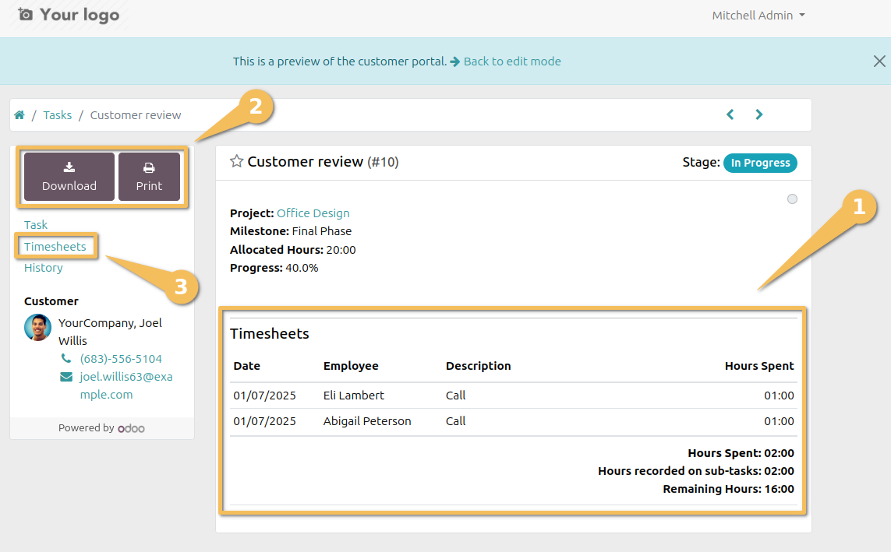
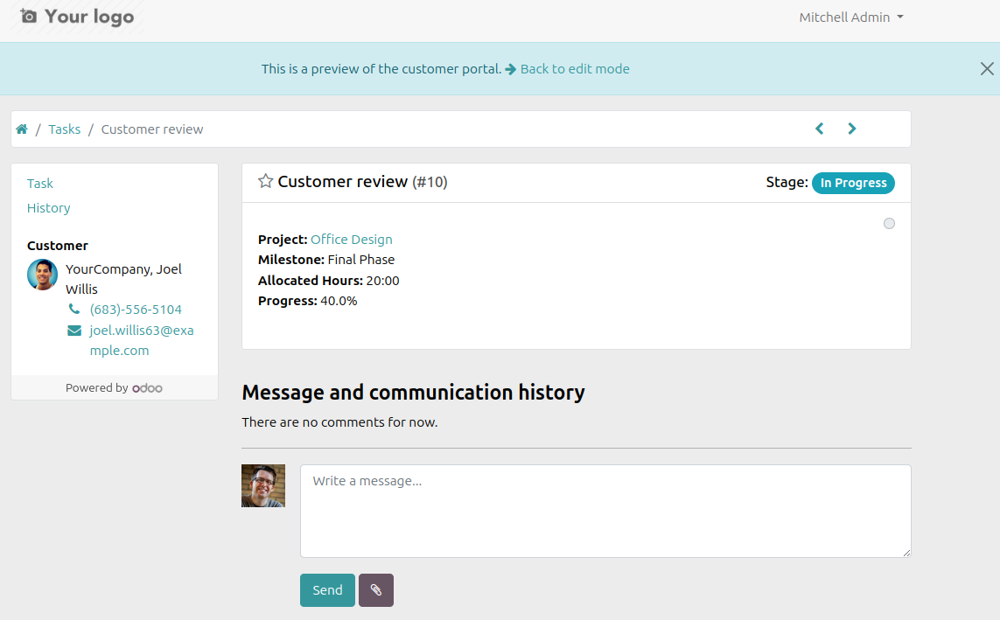

Project Portal Hide Timesheets
==============================
This module hides the timesheet lines from the portal.
And it also hides buttons that allow to print or download the timesheet lines.
The anchor link `Timesheets` (in the left) is also removed from the portal.
The `Time Spent` column is also hidden from the task list view.

*Before installing the module*

*After installing the module*

Contributors
------------
* Numigi (tm) and all its contributors (https://numigi.com/r/home)
