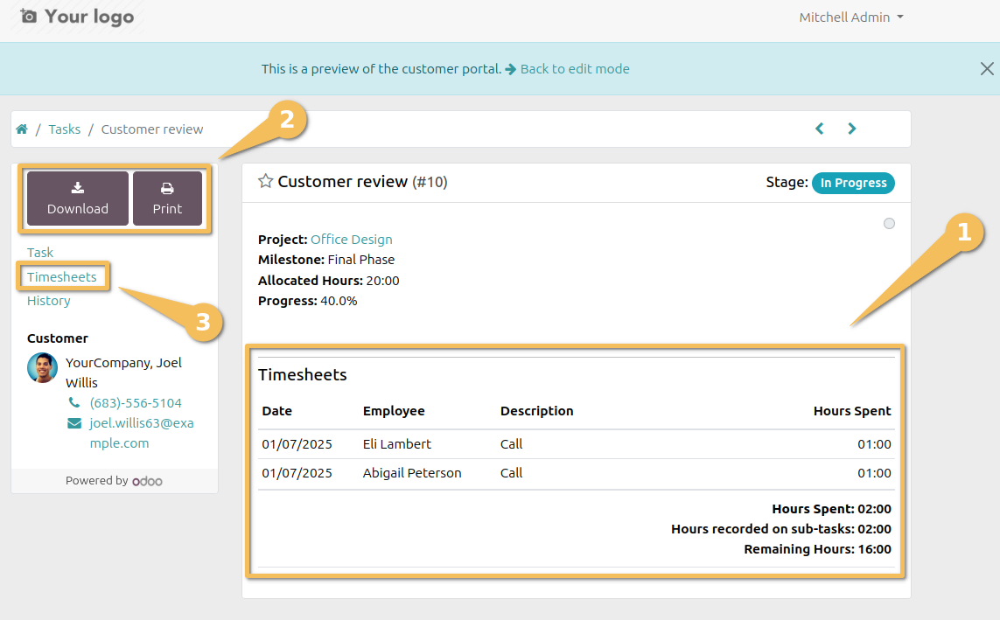
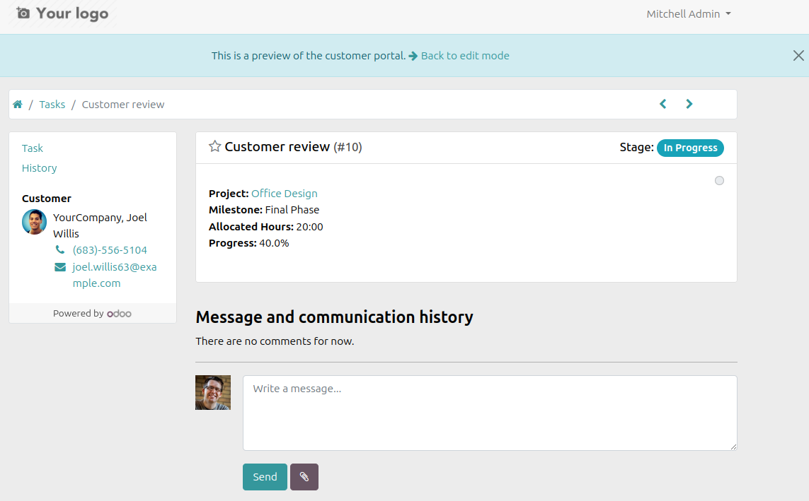

Project Portal Hide Timesheets
==============================
This module completely hides timesheet information from portal users.

Features
--------
* Hides the timesheet lines from the task portal view
* Hides buttons that allow to print or download the timesheet lines
* Removes the `Timesheets` anchor link from the portal navigation
* Hides the `Time Spent` column from the task list view
* Hides the `Allocated Hours` field from task portal views
* Hides the `Timesheets` menu entry from the portal home page (`/my`)
* Blocks access to the `/my/timesheets` portal route (returns 403 Forbidden)
* Prevents timesheet report generation for portal users

Implementation
--------------
This module uses a combination of techniques:

* **Python controllers**: Block access to timesheet routes with Forbidden exceptions
* **XML templates**: Hide timesheet UI elements by setting `t-if="False"` or disabling templates entirely
* **Model overrides**: Filter timesheet data to prevent it from being sent to portal users

This layered approach ensures timesheet information remains hidden even if portal users have web editor access.

*Before installing the module*

*After installing the module*

Contributors
------------
* Numigi (tm) and all its contributors (https://numigi.com/r/home)
